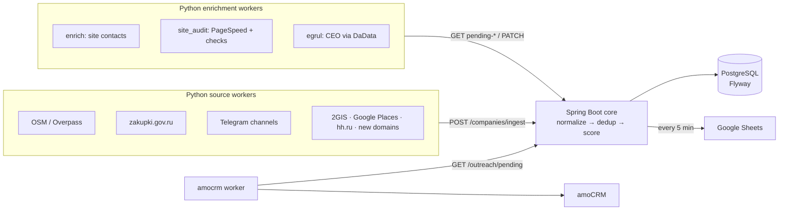

# b2b-lead-pipeline

B2B lead-generation pipeline for a small web/design studio: Python workers collect companies from public sources, a Java / Spring Boot core deduplicates and scores them in PostgreSQL, and hot leads go to Google Sheets and amoCRM.

[](https://github.com/nurzhan2/b2b-lead-pipeline/actions/workflows/ci.yml)   

## Problem

- A studio that builds sites, bots and automation needs a steady list of businesses that are likely to buy: no website, a broken website, or an open request for development.
- That signal is scattered across maps (OpenStreetMap, 2GIS, Google Places), government tenders, job boards and Telegram order channels, each with its own format, limits and rules.
- Raw scrapes overlap heavily and are mostly noise: the same company appears from three sources, and most entries are not worth a call.

## Features

- **Single ingest contract.** Every source posts to `POST /api/v1/companies/ingest`; adding a source means writing a worker, not changing the core.
- **Three-way deduplication.** Exact match on normalized domain and phone, then fuzzy name match (token-sort ratio ≥ 82) within the same city; duplicates are merged and only empty fields are filled.
- **Config-driven scoring.** All weights and thresholds live in `application.yml` (e.g. no site +40, direct intent +35, PageSpeed < 50 +30, HOT ≥ 70); `POST /api/v1/admin/rescore` re-applies a changed model to stored leads.
- **Enrichment passes as pull queues.** Workers fetch `pending-enrich` / `pending-audit` / `pending-egrul` batches and `PATCH` results back; the core marks each company as attempted exactly once.
- **Polite crawling.** The contact-enrichment worker implements its own robots.txt parser (RFC 9309), sends an identifying User-Agent, paces per site and refuses IP/localhost targets.
- **Idempotent CRM push.** The core hands out only HOT leads that have no outreach record for the channel and records one after the amoCRM worker confirms, so reruns do not create duplicate deals.
- **Live dashboard.** A scheduled job rewrites a formatted Google Sheet every 5 minutes: tabs by temperature, by source, call lists and a site-audit tab.

## Architecture



- **Source workers** each own one external API or site: pagination, rate limits, retries and mapping into the shared `RawCompanyRequest` shape.
- **The core** normalizes names, domains and phones, finds an existing company or creates one, scores the lead and stores both. It is the only component that writes to the database.
- **Enrichment workers** pull companies that still miss something (contacts, a site audit, a director's name), fetch it, and patch it back; the core re-scores on every patch.
- **Exports** read from the core: a Sheets sync on a fixed delay and an amoCRM worker for HOT leads.

## Tech stack

| Layer | Technology | Why |
|---|---|---|
| Core API | Java 21, Spring Boot 3.3, Spring Web, Bean Validation | Strict types and transactions for the logic that must be correct: dedup, scoring, the ingest contract |
| Persistence | PostgreSQL 16, Spring Data JPA, Flyway | Relational model plus a JSONB `raw` column for per-source fields; versioned migrations, Hibernate only validates |
| Fuzzy matching | FuzzyWuzzy (token-sort ratio) | Company names arrive with legal forms and word order shuffled ("ООО Ромашка Кофейня" vs "Кофейня Ромашка") |
| Workers | Python, asyncio, httpx, pydantic v2, tenacity, structlog | Cheap to write and replace per source; async I/O for many slow external calls; backoff on 429/5xx |
| Parsing | BeautifulSoup + lxml, Telethon | HTML of tender cards and company sites; Telegram channel monitoring |
| Export | Google Sheets API v4, amoCRM REST API | Where the studio actually works with leads |
| Tests | JUnit 5, Testcontainers, pytest, pytest-asyncio | Integration tests against a real PostgreSQL; workers tested with fake HTTP clients, no network |
| CI | GitHub Actions, ruff | Maven verify, lint, format check and pytest on every push |

## Key decisions & trade-offs

- **Polyglot: Java core, Python workers.** Alternative: one Python service. The core holds the rules that must stay consistent across sources, so it gets static types and JPA transactions; scrapers break often and are cheaper to rewrite in Python. Cost: two toolchains, and the `RawCompanyRequest` contract is duplicated as a Java DTO and a pydantic model.
- **Synchronous HTTP between workers and core, no queue.** Alternative: a message broker. At tens to hundreds of companies per run, direct HTTP with retries is enough and keeps local setup to one PostgreSQL container. Cost: if the core is down, a worker run fails and is simply rerun later; there is no buffering.
- **Work queues stored as flags in JSONB.** `pending-enrich`, `pending-audit` and `pending-egrul` select companies by flags such as `raw.audit_attempted` instead of separate job tables. Alternative: a job table per pass. Cost: no retry counts or error history per job, and the queries rely on JSONB expressions rather than plain indexed columns.
- **Score once at ingest, re-score explicitly.** Alternative: compute scores on read. Stored scores make `GET /leads/top` and the Sheets sync simple sorts. Cost: changing a weight does not affect old leads until `POST /admin/rescore` is run.
- **Each worker is self-contained.** Every worker has its own `requirements.txt`, `.env`, `core_client.py` and tests, so one can be deleted or rewritten without touching the others. Cost: the core client is copy-pasted across workers and must be updated in several places when the contract changes.

## Quick start

Requires Docker, JDK 21, Maven and Python 3.11+.

```bash
cp .env.example .env              # defaults work with the bundled PostgreSQL
docker compose up -d              # PostgreSQL 16 on :5432
mvn spring-boot:run               # core on :8081, Flyway creates the schema
```

Run a worker (OpenStreetMap needs no API key):

```bash
pip install -r workers/osm/requirements.txt
cp workers/osm/.env.example workers/osm/.env
python -m workers.osm.main        # from the repo root
curl "http://localhost:8081/api/v1/leads/top?limit=10"
```

Core environment variables:

| Variable | Purpose | Example |
|---|---|---|
| `DB_HOST`, `DB_PORT`, `DB_NAME` | PostgreSQL location | `localhost`, `5432`, `qorsa_leadgen` |
| `DB_USER`, `DB_PASSWORD` | PostgreSQL credentials | `qorsa`, `qorsa` (local only) |
| `SERVER_PORT` | Core HTTP port; every worker's `CORE_URL` defaults to 8081 | `8081` |
| `GOOGLE_CREDENTIALS_PATH` | Service-account JSON for the Sheets export; blank disables it | `credentials/google.json` |
| `SHEETS_SPREADSHEET_ID` | Target spreadsheet; blank disables the export | `1AbC...` |
| `SHEETS_SYNC_DELAY_MS` | Delay between Sheets syncs | `300000` |
| `ADMIN_ENABLED` | Enables the rescore and demo-data purge endpoints | `false` |

Each worker documents its own variables and API-key setup in `workers/<name>/.env.example` and `workers/<name>/README.md`.

## Testing

```bash
mvn verify          # Java: unit tests + Testcontainers integration tests (needs Docker)
pip install -r requirements-dev.txt
ruff check . && pytest
```

- **Core:** 91 tests. Unit tests cover phone classification, normalization, dedup and scoring; integration tests run the ingest, enrichment and admin endpoints and the repository queries against PostgreSQL in Testcontainers.
- **Workers:** 729 tests. Mappers, parsers (tender cards, contact pages, robots.txt), filters, dedup and runners driven by fake API and core clients instead of real HTTP calls.
- CI runs both suites on every push: [GitHub Actions](https://github.com/nurzhan2/b2b-lead-pipeline/actions/workflows/ci.yml).

## Project structure

```
src/main/java/kz/qorsa/leadgen/   Spring Boot core: domain, service, web, export, repository
src/main/resources/               application.yml (scoring weights), Flyway migrations
src/test/java/                    JUnit + Testcontainers tests
workers/                          one folder per Python worker, each with README, .env.example, tests
scripts/                          PowerShell pipeline runners and Excel call-list exports
.github/workflows/ci.yml          CI: Maven verify, ruff, pytest
docker-compose.yml                local PostgreSQL
```

Workers: `osm`, `zakupki`, `telegram_monitor`, `twogis`, `google_places`, `hh`, `newdomains` (sources); `enrich`, `site_audit`, `egrul` (enrichment); `amocrm` (export).

## Results

Local pilot, 14–17 September 2026, summed from the workers' `run_finished` log records (duplicates by timestamp removed):

| Worker | Runs | Result |
|---|---|---|
| OpenStreetMap | 8 | 2,400 companies sent to the core; 1,067 with a phone, 1,106 without a website (110 of 2,010 city × category pairs covered) |
| Government tenders | 7 | 2,100 notices parsed with their cards; 537 dropped as duplicates |
| Contact enrichment | 8 | 596 websites processed, contacts found for 377 (63%), 749 pages fetched within robots.txt |
| Site audit | 7 | 716 websites: 537 measured, 179 unreachable, 1,030 failed checks |
| Company registry (EGRUL) | 6 | 1,429 companies; director found for 355 (25%) |

- **Tests:** 820 in CI — 91 JUnit with Testcontainers on PostgreSQL, 729 pytest. Python line coverage 56.5% (enrichment 91%, hh 83%, OSM 79%; site audit has no tests yet).
- **Not reached:** no deals were created in amoCRM — the CRM token returned 401 on every run, so the pilot stopped at the Google Sheets stage (11,428 rows synced across 9 tabs).

## Limitations & roadmap

- **Not every source is usable without paid access.** 2GIS demo keys return no contacts, Google Places needs an activated billing account, hh.ru requires an approved OAuth application, and the new-domains feed is paid and has not been run against a live key.
- **Admin endpoints have no authentication.** Rescore and demo-data purge are guarded only by the `ADMIN_ENABLED` switch; ingest is open as well. Before any hosted deployment, add a token check (planned: `X-Ingest-Token` shared with workers).
- **Dedup is application-level only.** There is no unique constraint on normalized domain or phone, so two concurrent ingests of the same company could both insert. Fuzzy matching scans all companies in the same city, which is fine at thousands of rows, not at millions.
- **CRM idempotency relies on a read-before-write check,** not a unique `(lead_id, channel)` constraint; a database constraint would close the race.
- **Duplicated worker clients.** Extracting `core_client.py` into a shared package is the next refactor.
- **Runs are manual or script-driven** (`scripts/run_pipeline.ps1`); scheduling and a hosted deployment of the core are next.

## My role

Designed and built end-to-end: the Spring Boot core, the database schema, all workers, the Sheets and amoCRM exports and the test suites.

## License

MIT © Nurzhan Kalmurat · [LinkedIn](https://linkedin.com/in/kalmuratnurzhan)
